<p align="center">
  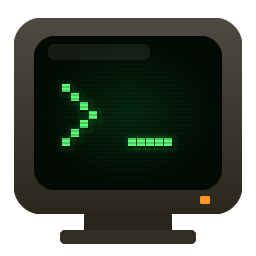
</p>

<h1 align="center">Hacker Terminal Retro</h1>

<p align="center">
  <b>Um terminal para Windows com cara de monitor CRT dos anos 80.</b><br>
  Fósforo âmbar e verde, curvatura do tubo, brilho, rastro, ruído e linhas de varredura,<br>
  rodando o seu PowerShell, cmd, WSL ou Git Bash de verdade.
</p>

<p align="center">
  
  
  
  
</p>

<p align="center">
  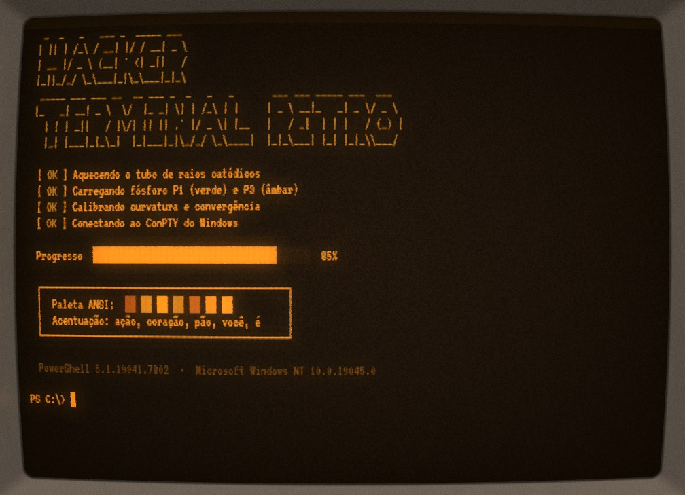
  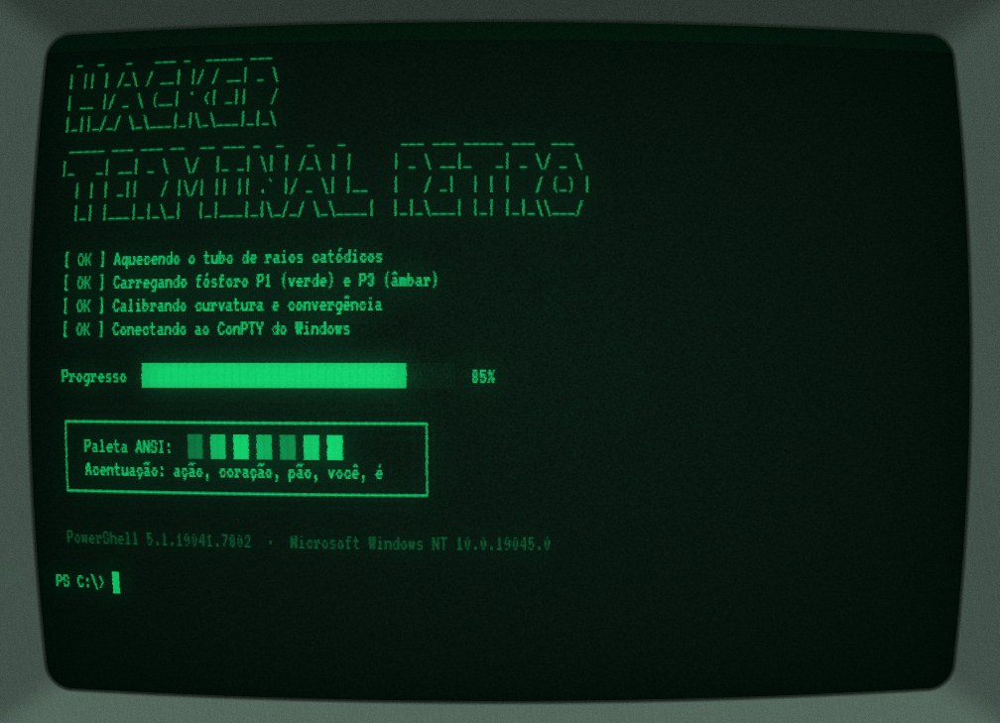
</p>

---

## Sumário

- [Download e instalação](#download-e-instalação)
- [Galeria de perfis](#galeria-de-perfis)
- [Funcionalidades](#funcionalidades)
- [Atalhos de teclado](#atalhos-de-teclado)
- [Linha de comando](#linha-de-comando)
- [Como funciona](#como-funciona)
- [Compilar a partir do código](#compilar-a-partir-do-código)
- [Documentação completa](#documentação-completa)
- [Créditos e licença](#créditos-e-licença)

---

## Download e instalação

Baixe a versão mais recente na página **[Releases](../../releases/latest)**:

| Arquivo | Para quem é |
|---|---|
| `HackerTerminalRetro-Setup-1.0.0.exe` | **Instalador.** Cria atalhos no Menu Iniciar e na Área de Trabalho e pode ser desinstalado pelo Windows. |
| `HackerTerminalRetro-Portable-1.0.0.exe` | **Portátil.** Um único `.exe`, sem instalação. Bom para pendrive. |

> **Aviso do SmartScreen:** os executáveis não têm assinatura digital paga, então na primeira execução o Windows
> pode mostrar *"O Windows protegeu o computador"*. Clique em **Mais informações → Executar assim mesmo**.

**Requisitos:** Windows 10 (1809 ou mais recente) ou Windows 11, x64, com uma placa de vídeo que suporte WebGL2
(qualquer GPU integrada dos últimos ~10 anos serve).

---

## Galeria de perfis

O app vem com **14 perfis prontos**, inspirados em computadores e terminais clássicos. Troque de perfil pelo menu do
botão direito → **Perfis**, ou em **Configurações → Geral**.

| | |
|:---:|:---:|
| <br>**Default Amber** — o clássico fósforo âmbar | <br>**Monochrome Green** — monitor de fósforo verde |
| 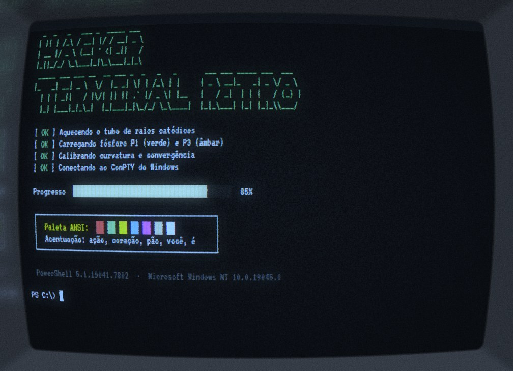<br>**Deep Blue** — azul com cores ANSI e moldura brilhante | 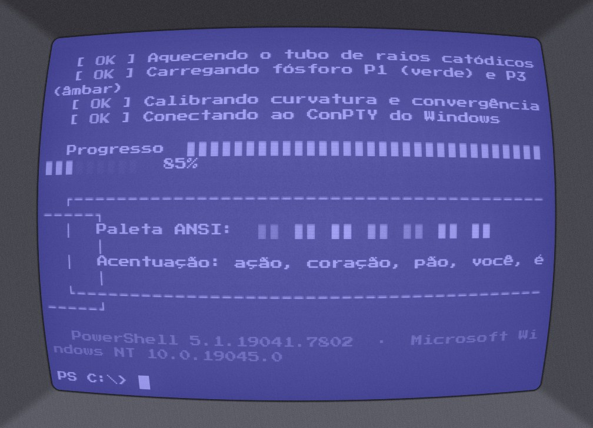<br>**Commodore 64** — fundo azul, fonte 8-bit e moldura grossa |
| 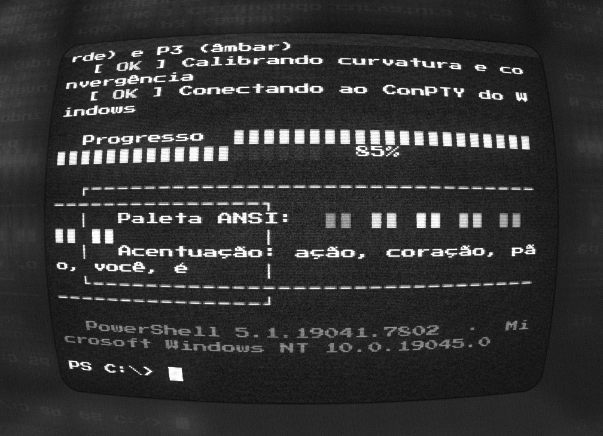<br>**Commodore PET** — branco, bem curvo, com ruído | 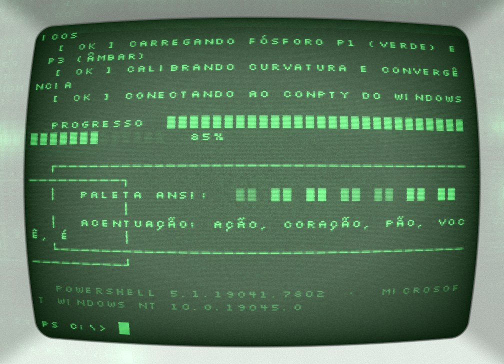<br>**Apple ][** — verde, com muita luz ambiente |
| 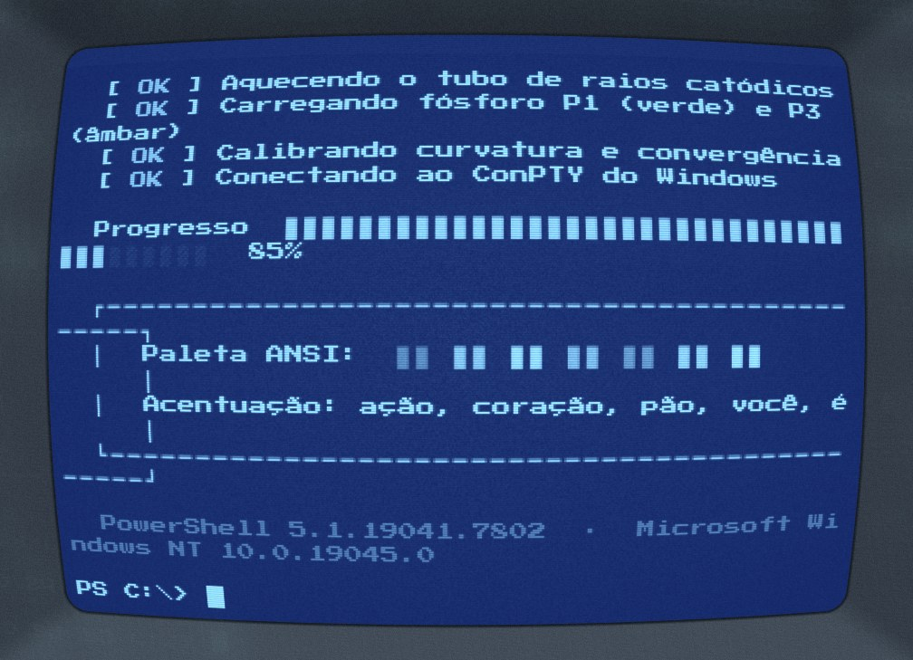<br>**Atari 400** — ciano sobre azul | 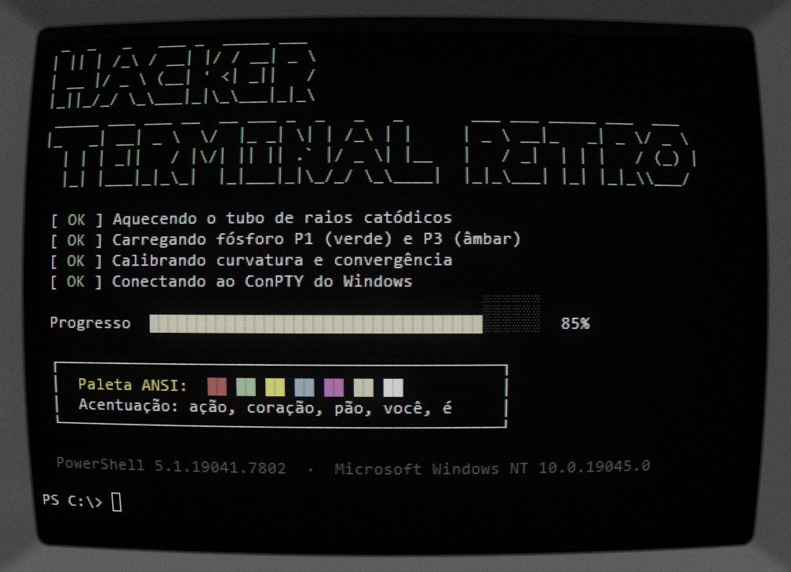<br>**IBM VGA 8x16** — o modo texto do PC |
| 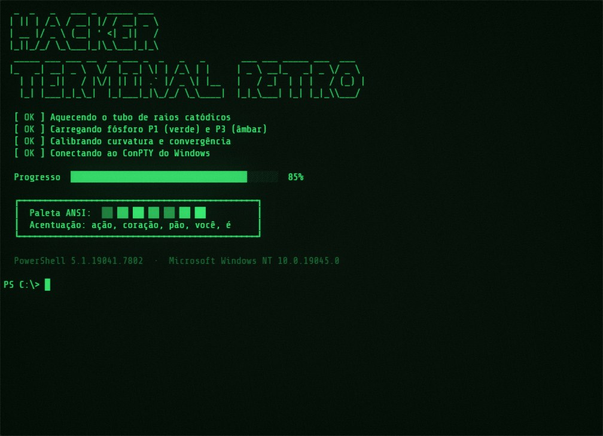<br>**IBM 3278 Reborn** — terminal de mainframe, tela plana | 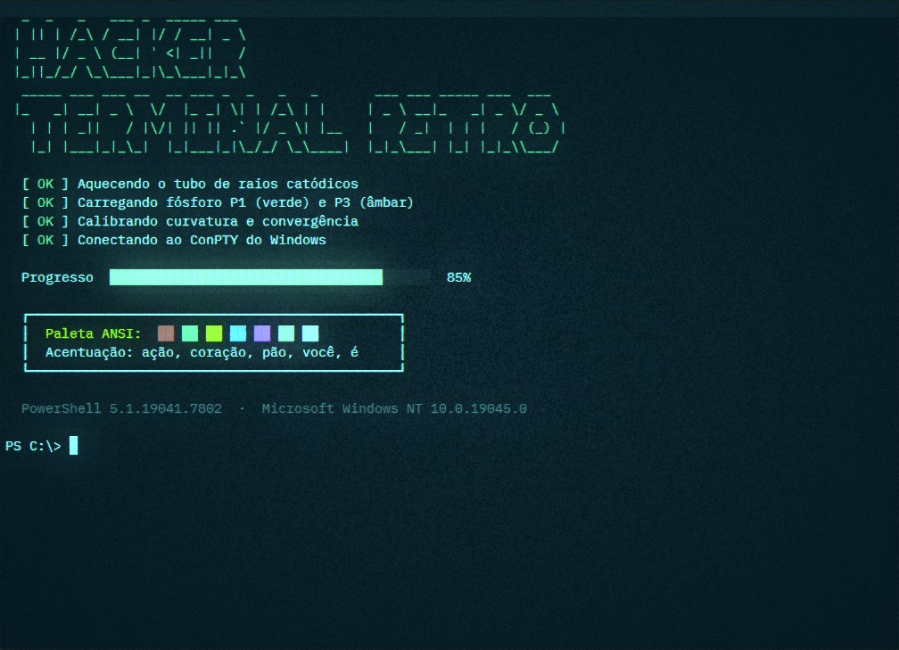<br>**Neon Cyan** — moderno, com janela translúcida |
| 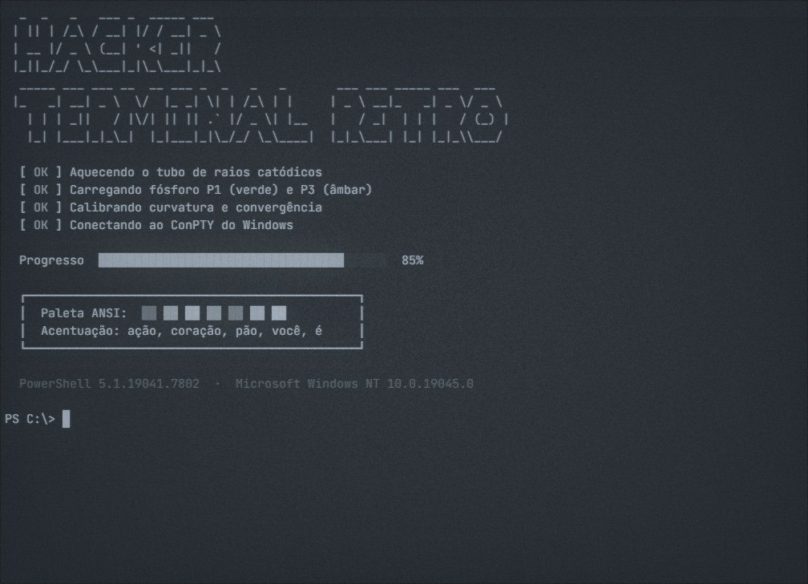<br>**Ghost Terminal** — discreto e translúcido | 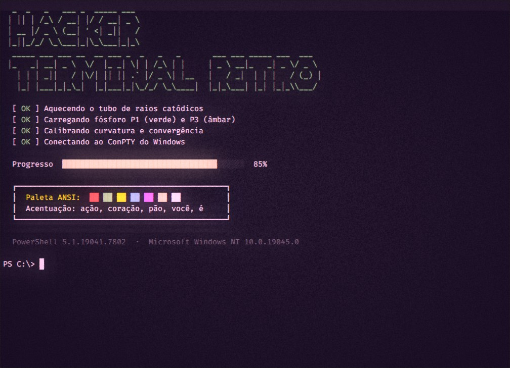<br>**Plasma** — rosa neon com aberração cromática |
| 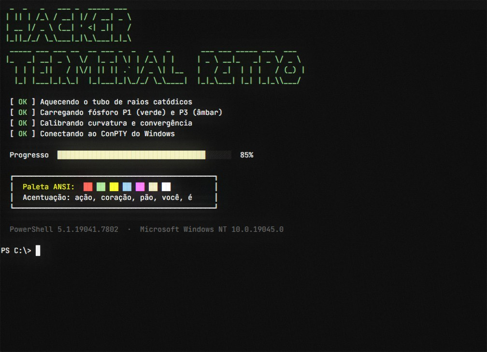<br>**Boring** — quase um terminal comum | 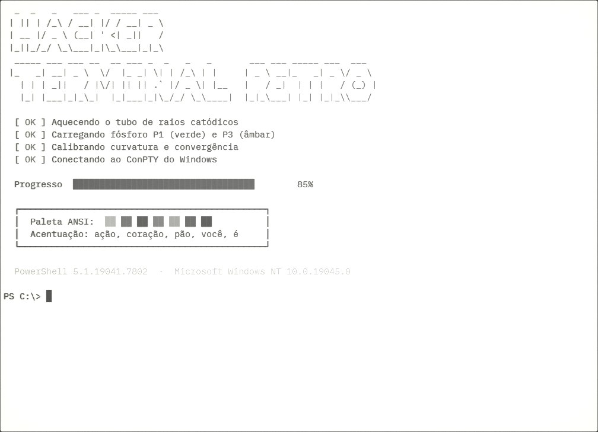<br>**E-Ink** — tema claro que imita papel eletrônico |

Você também pode criar, salvar, importar e exportar seus próprios perfis (JSON).

---

## Funcionalidades

**Terminal de verdade**
- Usa o **ConPTY** do Windows: tudo que roda no Windows Terminal roda aqui (PowerShell, PowerShell 7, cmd, WSL, Git Bash, `ssh`, `vim`, `htop`…).
- Emulação **xterm-256color** com *truecolor*, histórico configurável, títulos de janela, *bracketed paste*.
- **Abas** e **várias janelas**. Se você abrir o app de novo, ele cria uma nova janela na mesma instância.
- **Mouse em programas de terminal** (vim, htop, mc), com protocolos X10 e SGR.
- Seleção de texto que **funciona mesmo com a tela curva**: o clique é corrigido pela mesma fórmula de distorção do shader. Duplo clique seleciona uma palavra e triplo clique, a linha.

**Efeitos de CRT** (todos ajustáveis ou desligáveis)

| Efeito | O que faz |
|---|---|
| Bloom | brilho difuso ao redor das letras |
| Burn-in | o texto deixa um rastro que some aos poucos, como fósforo |
| Ruído estático | "chuvisco" granulado, mais forte no centro |
| Jitter | tremor fino dos caracteres |
| Linha de varredura | faixa clara que desce pela tela |
| Curvatura | tela abaulada, como um tubo de vidro |
| Luz ambiente | reflexo de luz no vidro |
| Cintilação | variação do brilho |
| Sincronismo horizontal | ondulação horizontal ocasional |
| Deslocamento RGB | bordas coloridas (aberração cromática) |
| Moldura | gabinete com sombras 3D e reflexo da tela |
| Rasterização | linhas de varredura, grade de pixels ou sub-pixels RGB |

**Personalização**
- 13 fontes: 8 incluídas (VT323, Press Start 2P, Silkscreen, Share Tech Mono, IBM Plex Mono, JetBrains Mono, Fira Code, Space Mono) e as fontes monoespaçadas do Windows.
- Cor da fonte, do fundo e da moldura, além de chroma, saturação, brilho, contraste e opacidade da janela.
- As configurações são salvas **automaticamente** a cada alteração.

<p align="center">
  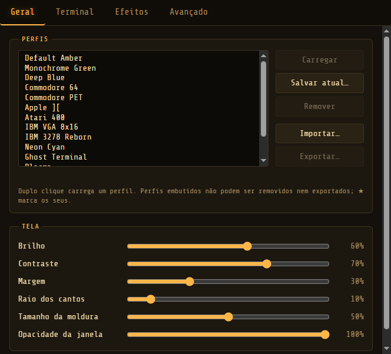
</p>

---

## Atalhos de teclado

| Ação | Atalho |
|---|---|
| Nova aba / fechar aba | `Ctrl+Shift+T` / `Ctrl+Shift+W` |
| Nova janela | `Ctrl+Shift+N` |
| Ir para a aba 1…9 | `Alt+1` … `Alt+9` |
| Próxima / anterior aba | `Ctrl+Tab` / `Ctrl+Shift+Tab` |
| Copiar | `Ctrl+Shift+C`, ou `Ctrl+C` com texto selecionado |
| Colar | `Ctrl+Shift+V`, `Shift+Insert` ou botão do meio |
| Selecionar tudo | `Ctrl+Shift+A` |
| Zoom + / − / padrão | `Ctrl+=` / `Ctrl+-` / `Ctrl+0`, ou `Ctrl` + roda do mouse |
| Rolar histórico | `Shift+PgUp` / `Shift+PgDn` ou roda do mouse |
| Limpar histórico | `Ctrl+Shift+K` |
| Tela cheia | `F11` |
| Configurações | `Ctrl+,` |
| Ajuda (lista de atalhos) | `F1` |
| Menu | botão direito (`Shift` + botão direito em programas que usam mouse) |

---

## Linha de comando

```
"Hacker Terminal Retro.exe" [opções]

  --default-settings   inicia com as configurações padrão
  --workdir <pasta>    pasta inicial do shell
  -p, --profile <nome> inicia com um perfil (ex.: "Commodore 64")
  --fullscreen         inicia em tela cheia
  --verbose            mostra informações de diagnóstico
  -e <comando> ...     executa um comando no lugar do shell (use por último)
  -v, --version        mostra a versão
  -h, --help           mostra a ajuda
```

Exemplo: abrir o `htop` do WSL num monitor de fósforo verde:

```
"Hacker Terminal Retro.exe" --profile "Monochrome Green" -e wsl htop
```

---

## Como funciona

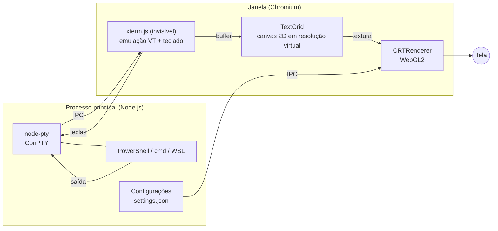

1. O **shell** roda num pseudo-console do Windows (**ConPTY**) controlado pelo processo principal.
2. Na janela, uma instância **invisível do xterm.js** interpreta as sequências de escape e captura o teclado.
3. O **TextGrid** lê o buffer do xterm.js e desenha os caracteres num canvas pequeno, na "resolução do monitor antigo".
4. O **CRTRenderer** (WebGL2) aplica os efeitos em passes: burn-in, bloom e uma composição final com curvatura, ruído, rasterização, cor e moldura.

Detalhes, fórmulas e decisões de projeto estão em **[docs/ARQUITETURA.md](docs/ARQUITETURA.md)**.

---

## Compilar a partir do código

Pré-requisitos: [Node.js](https://nodejs.org) 20 ou mais recente. Não precisa de Visual Studio: o `node-pty` já vem
pré-compilado.

```bash
git clone https://github.com/Hiagolim11/retro-terminal-windows.git
cd retro-terminal-windows
npm install
npm start          # roda em modo de desenvolvimento
npm run dist       # gera instalador e portátil em dist/
```

Para testar os efeitos sem instalar nada: `npm start -- --profile "Commodore 64"`.

---

## Documentação completa

| Documento | Conteúdo |
|---|---|
| [docs/GUIA-DE-USO.md](docs/GUIA-DE-USO.md) | Guia do usuário: cada opção das Configurações explicada, perfis, dicas e solução de problemas |
| [docs/ARQUITETURA.md](docs/ARQUITETURA.md) | Arquitetura, pipeline de renderização, shaders e estrutura do código |
| [CHANGELOG.md](CHANGELOG.md) | Histórico de versões |

---

## Créditos e licença

- Inspirado no **[cool-retro-term](https://github.com/Swordfish90/cool-retro-term)** de Filippo Scognamiglio.
  Os efeitos foram reimplementados para WebGL2 a partir de uma análise do app original.
- [xterm.js](https://xtermjs.org) (MIT), [node-pty](https://github.com/microsoft/node-pty) (MIT), [Electron](https://www.electronjs.org) (MIT).
- Fontes via [Fontsource](https://fontsource.org), sob a SIL Open Font License: VT323, Press Start 2P, Silkscreen,
  Share Tech Mono, IBM Plex Mono, JetBrains Mono, Fira Code e Space Mono.

Distribuído sob a **GNU General Public License v3.0 ou posterior**, a mesma licença do projeto original. Veja [LICENSE](LICENSE).
