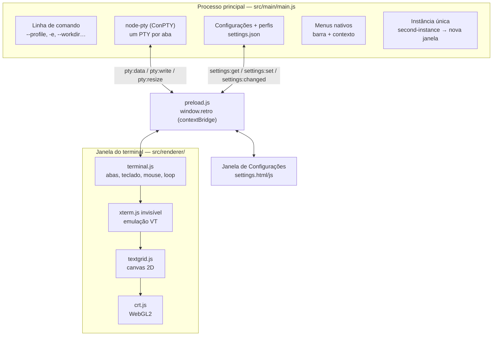
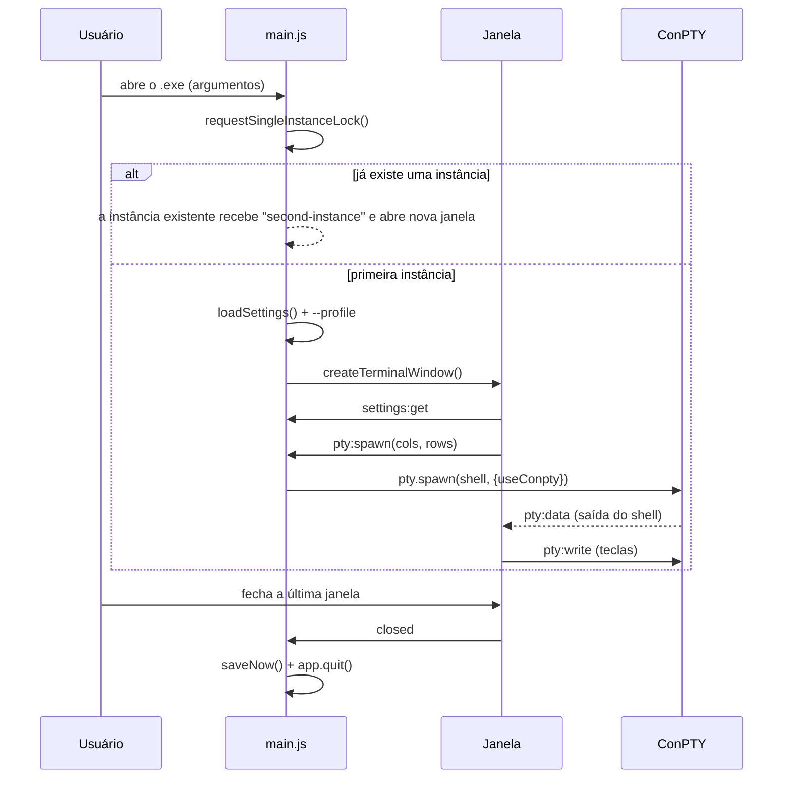
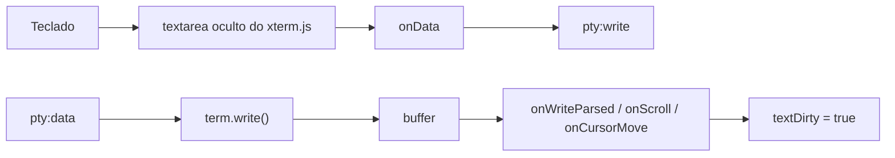
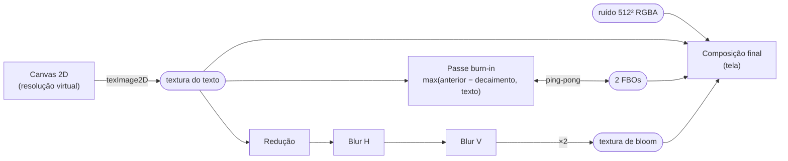

# Arquitetura

← [Voltar ao README](../README.md)

Este documento explica como o Hacker Terminal Retro funciona por dentro: os processos, o fluxo dos dados, o
pipeline gráfico e as fórmulas de cada efeito.

## Sumário

1. [Visão geral](#1-visão-geral)
2. [Estrutura de pastas](#2-estrutura-de-pastas)
3. [Processo principal](#3-processo-principal)
4. [Janela do terminal](#4-janela-do-terminal)
5. [Resolução virtual e fontes pixeladas](#5-resolução-virtual-e-fontes-pixeladas)
6. [Pipeline de renderização](#6-pipeline-de-renderização)
7. [Fórmulas dos efeitos](#7-fórmulas-dos-efeitos)
8. [Mouse em tela curva](#8-mouse-em-tela-curva)
9. [Configurações e perfis](#9-configurações-e-perfis)
10. [Comparação com o cool-retro-term](#10-comparação-com-o-cool-retro-term)
11. [Empacotamento](#11-empacotamento)
12. [Modo de diagnóstico](#12-modo-de-diagnóstico)

---

## 1. Visão geral



São dois tipos de processo, como em todo app Electron:

- **Processo principal** (Node.js): cria as janelas, roda os shells via ConPTY, guarda as configurações e monta os menus.
- **Processos de janela** (Chromium, com sandbox e `contextIsolation`): interface, emulação de terminal e renderização.
  Eles não acessam o Node diretamente, só a API `window.retro` exposta pelo `preload.js`.

## 2. Estrutura de pastas

```
retro-terminal-windows/
├── src/
│   ├── main/
│   │   ├── main.js        processo principal: janelas, PTY, IPC, menus, CLI, persistência
│   │   ├── preload.js     ponte segura (contextBridge) → window.retro
│   │   └── config.js      padrões, fontes, shells e os 14 perfis embutidos
│   └── renderer/
│       ├── terminal.html/.css/.js   janela do terminal
│       ├── textgrid.js    desenha o buffer do xterm.js num canvas 2D
│       ├── crt.js         renderizador WebGL2 (shaders GLSL ES 3.0)
│       ├── settings.html/.js        janela de Configurações
│       ├── about.html/.js           janela Sobre
│       ├── ui.css         estilo das janelas auxiliares
│       ├── fonts.css + fonts/       fontes incluídas (woff2)
│       ├── vendor/        xterm.js + xterm.css
│       └── icon.png       ícone (gerado por scripts/make-icon.js)
├── scripts/
│   ├── make-icon.js       gera o ícone em pixel art (codificador PNG próprio)
│   └── demo.ps1           demonstração usada nas capturas de tela
├── docs/                  documentação e imagens
└── package.json           dependências + configuração do electron-builder
```

## 3. Processo principal

### Ciclo de vida



### Shell

O comando de cada aba é escolhido nesta ordem (`resolveCommand`):

1. `-e <cmd> args…` da linha de comando (só na primeira aba da janela);
2. **comando personalizado** das configurações, quebrado em argumentos por um tokenizador com suporte a aspas;
3. o **shell padrão** escolhido (PowerShell, pwsh, cmd, WSL ou Git Bash).

O PTY é criado com `name: 'xterm-256color'`, `COLORTERM=truecolor` e `useConpty: true`.

### IPC

| Canal | Direção | Uso |
|---|---|---|
| `pty:spawn` | janela → principal (invoke) | cria um PTY e devolve o `id` |
| `pty:write` / `pty:resize` / `pty:kill` | janela → principal | entrada, tamanho e encerramento |
| `pty:data` / `pty:exit` | principal → janela | saída e fim do processo |
| `settings:get` / `settings:set` | janela → principal | ler e alterar uma chave |
| `settings:changed` | principal → todas as janelas | novo estado completo (broadcast) |
| `profile:load/save/remove/import/export` | janela → principal | gerenciar perfis |
| `app:action` | ambos | ações de menu e atalhos (nova aba, copiar, zoom…) |
| `menu:context` | janela → principal | abre o menu de contexto nativo |
| `clipboard:read/write` | janela → principal | área de transferência |

## 4. Janela do terminal

Cada aba tem um `Terminal` do **xterm.js** aberto dentro de um contêiner **invisível** (`opacity: 0`). O xterm.js
cuida do que é difícil: parser VT/xterm, buffer com histórico, modos de teclado, codificação das teclas, seleção e
*bracketed paste*. O que se vê na tela é desenhado por nós.



O loop de renderização (`requestAnimationFrame`) só redesenha quando é preciso:

- **texto mudou** → redesenha o canvas, envia a textura e recalcula o bloom;
- **efeito animado ligado** (ruído, jitter, cintilação, sincronismo, linha de varredura) → recompõe a cada N quadros (*FPS dos efeitos*);
- **burn-in ainda se apagando** → continua até o rastro sumir.

Com o perfil *Boring* e a tela parada, a GPU fica praticamente ociosa.

**Foco do teclado:** clicar num `<canvas>` normalmente tira o foco do `textarea` do xterm.js. Por isso, o `mousedown`
chama `preventDefault()`, um ouvinte de `focusout` devolve o foco ao terminal, e um ouvinte de `keydown` na janela
serve de rede de segurança.

## 5. Resolução virtual e fontes pixeladas

Monitores antigos tinham poucos pixels. Para imitar isso, o texto é desenhado num canvas **menor** que a janela, e o
shader amplia esse canvas.

```
k        = fator de ampliação (pixels de tela por pixel virtual)
virtW    = larguraJanela / (k × larguraDaFonte)
virtH    = alturaJanela / k
colunas  = (virtW − 2 × margem) / larguraDaCélula
linhas   = (virtH − 2 × margem) / alturaDaCélula
```

| Tipo de fonte | k | Resultado |
|---|---|---|
| Pixelada (VT323, Press Start 2P…) fora do modo Moderna | `22 × escala × dpr / tamanhoBase` | pixels grandes e visíveis |
| Alta resolução, ou modo Moderna | 1 | texto nítido na resolução da tela |

Para ampliar sem borrar e sem serrilhar, o shader usa amostragem *sharp bilinear*: arredonda a coordenada para o
centro do texel e só interpola na borda, numa faixa de um pixel de tela (calculada com `fwidth`).

As cores ANSI são desenhadas "cruas" (branco sobre preto por padrão). A conversão para âmbar, verde etc. acontece no
shader (`convertWithChroma`), o que permite variar o chroma sem redesenhar o texto.

## 6. Pipeline de renderização



| Passe | Shader | Resolução | Quando roda |
|---|---|---|---|
| Burn-in | `FRAG_BURN` | virtual × qualidade do burn-in | a cada quadro renderizado, se burn-in > 0 |
| Bloom | `FRAG_COPY` + 2 × (`FRAG_BLUR` H + V) | virtual × qualidade do bloom × 0,5 | quando o texto muda |
| Final | `FRAG_FINAL` | janela × qualidade da textura | a cada quadro renderizado |

Os passes intermediários usam `gl_FragCoord / tamanho` como coordenada. Assim, todas as texturas ficam com a mesma
orientação da textura do texto, sem inverter o eixo Y.

## 7. Fórmulas dos efeitos

Coordenadas de 0 a 1, com `uv` = posição na janela.

| Efeito | Implementação |
|---|---|
| Moldura + curvatura | `p = uv·(1+2f) − f`; `c = p − 0,5`; `d = |c|²·curvatura`; `tc = p + c·(1+d)·d` |
| Sincronismo horizontal | `x += sin((y + t)·freq)·escala`; a cada passo de tempo sorteia `escala = max(0, força − rnd)·força·hsync` e `freq ∈ [4, 40]` |
| Jitter | `tc += (ruído.zw − 0,5)·(0,007; 0,002)·jitter` |
| Ruído estático | `+ ruído.w · intensidade · (1 − 1,3·distânciaDoCentro)` |
| Linha de varredura | `fract(smoothstep(−120, 0, y − (H + 120)·fract(t·0,15)))` |
| RGB shift | 3 amostras deslocadas, com pesos R(0,1 / 0,3), G(0,2 / 0,2), B(0,3 / 0,1) e 0,6 no centro |
| Bloom | `+ blur · bloom · 0,55` |
| Burn-in | `acc = max(acc − dt/tempoDeFade, texto)`, com `tempoDeFade = lerp(0,16 s; 1,6 s; burnIn)`; na tela: `max(texto, acc·0,65)` |
| Rasterização | máscara por pixel virtual: varredura `1−|y|`, pixels `min(1−|y|, 1−0,9|x|)`, sub-pixels com fases RGB de 90°, −30° e −150°; mistura entre `(0,7+0,1c)c` e `(1,3−0,2c)c` |
| Chroma | `cinza = 0,21R + 0,72G + 0,04B`; `frente = mix(corFonte, cor·corFonte/cinza, chroma)`; `saída = mix(fundo, frente, cinza)` |
| Cintilação | `brilho = 1 + (rnd − 0,5)·flickering` |
| Luz ambiente | `vidro = ambiente·√(x(1−x)·y(1−y)·25)`, misturado a 30% |
| Moldura | SDF de retângulo arredondado; sombra por lado (leste/oeste 0,66, norte 0,33, sul 1,0); ruído de ±2% |
| Reflexo na moldura | fora da tela, coordenadas espelhadas `1 − |1 − |tc||`, com bloom e texto refletidos × brilho da moldura |
| Dithering | `± 1%` de ruído por pixel, contra faixas no gradiente |

As cores derivadas do perfil (em `terminal.js → profileColors`):

```
saturada  = mix(corFonte, branco, saturação × 0,5)
k         = 0,7 + contraste × 0,3
fonte     = mix(fundo, saturada, k)
fundoFinal= mix(saturada, fundo, k)
moldura   = mix(0,2 × mix(fonte, fundo, 0,2), corMoldura + 0,1, 0,125 + 0,75 × luzAmbiente)
```

## 8. Mouse em tela curva

O shader lê a textura em `tc = distorção(uv)`. Para descobrir qual caractere está sob o mouse, `eventToCell()` aplica
**a mesma função de distorção** à posição do clique e converte o resultado para linha e coluna. Por isso a seleção
acompanha o texto mesmo nos cantos curvados.

Quando um programa ativa o rastreamento de mouse (`term.modes.mouseTrackingMode`), os eventos são codificados em
**SGR** (`ESC[<b;x;yM`) ou **X10** (`ESC[M…`), conforme o modo pedido, e enviados ao PTY.

## 9. Configurações e perfis

- O estado tem três partes: `general` (não faz parte do perfil), `profile` (aparência atual) e `customProfiles`.
- Toda alteração passa pelo processo principal (`settings:set`), que valida a chave, salva com *debounce* de 400 ms
  e envia o estado novo a todas as janelas.
- Perfis importados são **sanitizados**: só as chaves conhecidas, com o tipo certo, são aceitas.
- Com `--default-settings`, o arquivo salvo não é sobrescrito, a menos que o usuário mude algo.

## 10. Comparação com o cool-retro-term

| | cool-retro-term (original) | Hacker Terminal Retro |
|---|---|---|
| Plataforma | Linux / macOS | **Windows** |
| Framework | Qt 6 / QML | Electron |
| Terminal | QMLTermWidget (Konsole) | xterm.js + ConPTY |
| Shaders | 62 variantes `.qsb` pré-compiladas | 4 programas GLSL ES 3.0, com ramos por uniform |
| Persistência | SQLite, salvo **só ao sair** | JSON, salvo **a cada alteração** |
| Perfis duplicados | permitidos (bug) | recusados |
| Perfis sem `version` | rejeitados | aceitos |
| Cores | `/256` (levemente escurecidas) | `/255` |
| Botão "Remove" | chama `selection.clear()` inexistente | corrigido |

A análise completa do original está em [RELATORIO-COOL-RETRO-TERM.md](RELATORIO-COOL-RETRO-TERM.md).

## 11. Empacotamento

O `electron-builder` gera dois executáveis (`npm run dist`):

- `nsis`: instalador por usuário, com escolha de pasta e atalhos;
- `portable`: um único `.exe` que se extrai sozinho.

Pontos importantes no `package.json`:

- `"npmRebuild": false`: o `node-pty` 1.1 usa N-API e traz binários prontos para Windows, então não é preciso compilar
  com o Visual Studio.
- `"asarUnpack": ["node_modules/node-pty/**/*"]`: os `.node`, o `conpty.dll` e o `OpenConsole.exe` precisam ficar fora
  do arquivo `.asar` para serem carregados.

## 12. Modo de diagnóstico

Variáveis de ambiente usadas para testes automatizados e para gerar as imagens desta documentação:

| Variável | Efeito |
|---|---|
| `HTR_CAPTURE=arquivo.png` (ou `.jpg`) | salva uma captura de cada janela após alguns segundos |
| `HTR_TYPE=texto` | envia o texto ao shell (`\r` = Enter) |
| `HTR_KEYS=texto` | clica na tela e digita com eventos de teclado reais (`~` = Enter) |
| `HTR_ACTIONS=a,b:arg` | executa ações (`newTab`, `settings:effects`…) |
| `HTR_CAPTURE_DELAY`, `HTR_TYPE_WAIT` | tempos de espera em ms |

Exemplo:

```powershell
$env:HTR_CAPTURE = "$PWD\captura.png"; npm start -- --profile "Apple ]["
```
